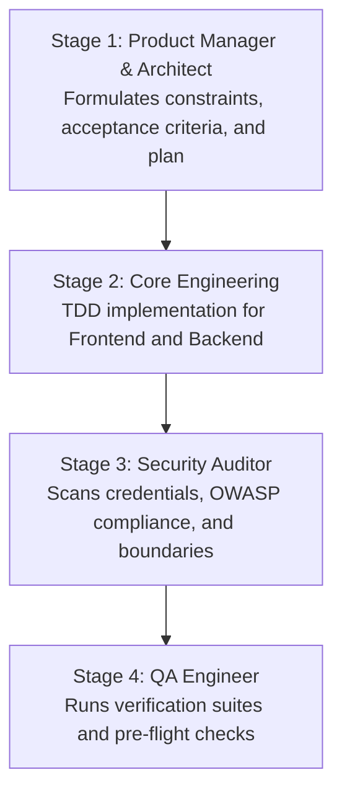

# Developer Cycle Pipeline (`/startcycle`)

This skill coordinates specialized personas to implement features or fixes through an automated pipeline.

## Pipeline Stages

### Stage 1: Product Manager & Architect
- Reads requirements and checks `.agents/skills.config.yaml`.
- Establishes acceptance criteria, file boundaries, and non-goals.
- Requires signoff before executing code modifications.

### Stage 2: Core Engineering
- **Backend**: Implements Pydantic V2 models and FastAPI simulator routes under `backend/`.
- **Frontend**: Implements clean, broadcast-grade UI components under `frontend/src/components/`. Forbids cartoon icons or AI template clutter.
- Runs local unit tests during Red-Green-Refactor cycles.

### Stage 3: Security Auditor
- Audits `.env` and checks that no sensitive API keys or credentials are committed.
- Verifies CORS headers and input validation sanitization.

### Stage 4: QA Engineer & Preflight
- Executes `./scripts/test_all.sh` (backend tests, lambda tests, frontend bundle, and CDK synth).
- Executes `python3 .agents/skills/production-readiness/scripts/preflight_check.py`.

