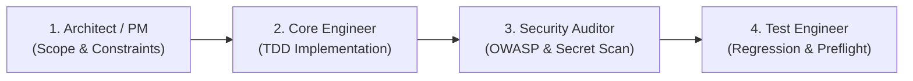

# DreamCompanion: Corner Edition - Agent Guidelines & Context

Welcome to the **DreamCompanion: Corner Edition** codebase. This file specifies operational rules, architectural boundaries, exact developer tool commands, automated pipelines, and security protocols for Google Antigravity agents working in this workspace.

---

## 1. Concrete Commands

Always execute exact, copy-pasteable commands. Never use vague instructions.

### Environment Setup
```bash
# Set up Python virtual environment and dependencies
python3 -m venv .venv
source .venv/bin/activate
pip install -r backend/requirements.txt

# Install Frontend dependencies
cd frontend && npm install && cd ..

# Install Infrastructure dependencies
cd infra && npm install && cd ..
```

### Verification & Testing
```bash
# Run the entire test & build suite in one command
./scripts/test_all.sh

# Run Backend Simulator unit tests
PYTHONPATH=backend .venv/bin/pytest backend/tests/ -v

# Run 'Ask Corner' Lambda unit tests
PYTHONPATH=lambda_ask_corner .venv/bin/pytest lambda_ask_corner/test_handler.py -v

# Run Frontend production bundle build
cd frontend && npm run build && cd ..

# Synthesize AWS CDK CloudFormation Stack
cd infra && npx cdk synth && cd ..
```

### Local Development
```bash
# Run both FastAPI backend (:8000) and React frontend (:3000) concurrently
./scripts/run_local.sh
```

### Cloud Deployment
```bash
# Deploy full stack to AWS (Amplify + App Runner + Lambda + API Gateway)
./deploy.sh
```

---

## 2. Permission Boundaries & Guardrails

Antigravity agents must respect the following autonomy tiers:

### Autonomous Operations (No Approval Needed)
- Reading, searching, and analyzing any codebase file.
- Creating and editing source code files within designated module boundaries.
- Running localized unit tests (`pytest`, `npm test`, `npm run build`).
- Running syntax/type linters and pre-flight readiness checks (`python3 .agents/skills/production-readiness/scripts/preflight_check.py`).
- Managing local virtual environments (`.venv`) and testing local servers.

### Restricted Operations (Explicit Human Confirmation Required)
- **Infrastructure Deployment**: Running `cdk deploy`, `sam deploy`, or `./deploy.sh`.
- **Git Remote Mutations**: Running `git push`, deleting remote branches, or force-pushing.
- **Dependency Ingestion**: Adding new external packages with non-standard licenses or heavy footprints.
- **Secret Modification**: Touching or printing production credentials or API keys.
- **Destructive File Operations**: Bulk deleting files or removing git tracking (`git rm`).

---

## 3. Strict Security Protocols

1. **Zero Credential Exposure**: Never hardcode API keys, AWS credentials (`AWS_ACCESS_KEY_ID`, `AWS_SECRET_ACCESS_KEY`), session tokens, or sensitive user data into any Markdown, JSON, YAML, or source code file.
2. **Environment Variable Ingestion**: All sensitive configurations must be ingested strictly via environment variables or the `.env` file (loaded via `python-dotenv` or runtime process environments).
3. **Git Hygiene**: Verify that `.env`, `cdk.out/`, and temporary build artifacts remain strictly inside `.gitignore`.
4. **Sanitization Guard**: Always sanitize API key strings before logging (e.g., truncate to `AIzaSy...` or check string length). Never print raw secret values in tool summaries or logs.

---

## 4. Hierarchical Directory Context

Localized guidelines are distributed across nested `AGENTS.md` files:

- [`frontend/AGENTS.md`](file:///Users/ponk6745/Desktop/DreamCompanion/frontend/AGENTS.md): React 18, TailwindCSS, SVG visualization, zero-icon minimalism, and WebSocket handling.
- [`backend/AGENTS.md`](file:///Users/ponk6745/Desktop/DreamCompanion/backend/AGENTS.md): FastAPI architecture, `/ws/simulator` broadcast state machine, and Pydantic V2 models.
- [`lambda_ask_corner/AGENTS.md`](file:///Users/ponk6745/Desktop/DreamCompanion/lambda_ask_corner/AGENTS.md): Serverless AI chat handler, Gemini/Claude routing, and CSK Fan Lore Pack.
- [`infra/AGENTS.md`](file:///Users/ponk6745/Desktop/DreamCompanion/infra/AGENTS.md): AWS CDK v2 TypeScript constructs for Amplify, App Runner, Lambda, and API Gateway.

---

## 5. Automated Developer Pipelines

When executing multi-stage feature requests or refactors, chain agent personas according to this sequence:



### Pipeline Workflow:
1. **Phase 1: Architecture & Plan Formulation**
   - Check `.agents/skills.config.yaml` for project-level constraints.
   - Enforce `constraint-driven-dev` planning with Red-Green-Refactor cycles.
2. **Phase 2: Minimal Viable Implementation**
   - Implement minimal atomic changes under 150 diff lines per step.
   - Keep UI minimalist, clean, and broadcast-grade (avoid AI template clutter or cartoon icons).
3. **Phase 3: Security & Secret Scan**
   - Run dependency audit and scan for accidental credential leakage.
4. **Phase 4: Pre-Flight Verification**
   - Execute `./scripts/test_all.sh` to ensure all 15 tests and CDK synthesis pass before hand-off.

