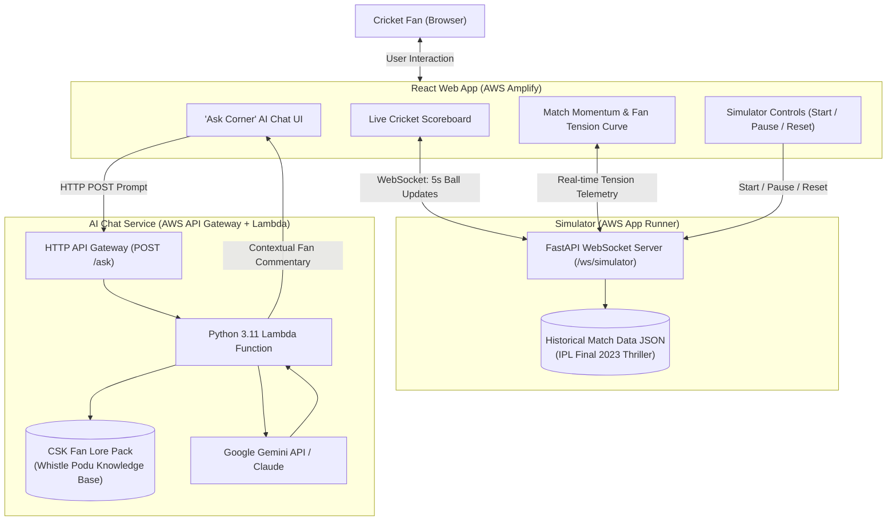

# DreamCompanion: Corner Edition

A real-time sports tech artifact featuring a synchronized split-screen cricket experience:
- **Top Half**: Live-updating cricket scoreboard (ball-by-ball updates, active batsmen/bowler figures, match equation, and live commentary).
- **Bottom Right**: Match Momentum & Fan Tension curve tracking emotional swings across every delivery.
- **Bottom Left**: "Ask Corner" AI companion powered by Google Gemini (with an offline CSK Fan Lore fallback).
- **Backend**: FastAPI WebSocket match simulator streaming realistic delivery telemetry.
- **Infrastructure**: Complete AWS CDK and SAM Infrastructure as Code (Amplify, App Runner, API Gateway, Lambda).

---

## Architecture Overview



---

## Directory Structure

```text
DreamCompanion/
├── frontend/                     # React 18 + Vite + TailwindCSS
│   ├── src/
│   │   ├── components/
│   │   │   ├── Scoreboard.jsx    # Top half: Cricket scorecard (runs, overs, wickets, ball capsules)
│   │   │   ├── FanECG.jsx        # Bottom right: Match momentum & tension graph
│   │   │   ├── AskCornerChat.jsx # Bottom left: Clean "Ask Corner" AI chat
│   │   │   ├── MatchControls.jsx # Minimalist controls: Start, Pause, Reset, Speed
│   │   │   └── Header.jsx        # Header & live WebSocket status indicator
│   │   ├── services/
│   │   │   ├── websocket.js      # WebSocket client with auto-reconnect
│   │   │   └── api.js            # HTTP client for API Gateway /ask endpoint
│   │   ├── constants/
│   │   │   └── fallbackData.js   # Initial state baseline data
│   │   ├── App.jsx               # Split-screen responsive layout
│   │   ├── main.jsx              # Application bootstrap
│   │   └── index.css             # Tailwind base & layout styles
│   ├── package.json
│   ├── vite.config.js
│   ├── tailwind.config.js
│   └── amplify.yml               # AWS Amplify Hosting build specification
├── backend/                      # Python FastAPI Match Simulator
│   ├── app/
│   │   ├── main.py               # FastAPI entrypoint, WebSocket /ws/simulator, CORS, health probe
│   │   ├── simulator.py          # State machine iterating ball-by-ball
│   │   ├── models.py             # Pydantic V2 schemas (DeliveryUpdate, MatchInfo, SimulatorState)
│   │   └── data/
│   │       └── match_data.json   # 2023 IPL Final ball-by-ball dataset with AI commentary
│   ├── tests/
│   │   ├── test_simulator.py     # Simulator state progression tests
│   │   └── test_api.py           # REST endpoints and health check tests
│   ├── Dockerfile                # Container definition for AWS App Runner
│   ├── requirements.txt
│   └── .dockerignore
├── lambda_ask_corner/            # Live "Ask Corner" AI Chat Lambda
│   ├── handler.py                # Lambda handler, CORS parser, LLM router (Gemini/Claude/Fallback)
│   ├── fan_lore.py               # Chennai Super Kings Fan Lore Pack knowledge base
│   ├── test_handler.py           # Lambda unit test suite
│   └── requirements.txt
├── infra/                        # AWS CDK v2 Infrastructure as Code (TypeScript)
│   ├── bin/
│   │   └── dream-companion.ts    # CDK App entrypoint
│   ├── lib/
│   │   └── dream-companion-stack.ts # CDK Stack (Amplify, App Runner, API Gateway, Lambda)
│   ├── package.json
│   ├── tsconfig.json
│   └── cdk.json
├── sam/                          # Alternative AWS SAM template
│   └── template.yaml
├── scripts/
│   ├── run_local.sh              # Run frontend and backend concurrently for local testing
│   └── test_all.sh               # Run all test suites and synth checks
├── deploy.sh                     # Automated one-click AWS CLI deployment script
├── .env.example                  # Environment template
└── README.md
```

---

## How to Run & Test the Application

### 1. Run All Tests
Verify all components in under 5 seconds:
```bash
./scripts/test_all.sh
```
Executes:
- 10 Backend tests (`backend/tests/`)
- 5 Lambda handler tests (`lambda_ask_corner/test_handler.py`)
- Frontend production bundle build (`frontend/dist`)
- AWS CDK CloudFormation template synthesis

### 2. Launch Locally (1 Step)
```bash
./scripts/run_local.sh
```
This serves:
- **Frontend**: `http://localhost:3000`
- **Backend Simulator**: `http://localhost:8000` (WebSocket at `ws://localhost:8000/ws/simulator`)

Open `http://localhost:3000` and click **"Start Match"** to begin the simulation.

---

## AI Configuration (`.env`)

The project supports two operational modes:

### Mode 1: Free Tier AI (Google Gemini)
1. Generate a free API key at **[https://aistudio.google.com/app/apikey](https://aistudio.google.com/app/apikey)** (no credit card required).
2. Set it in your `.env` file:
   ```env
   GEMINI_API_KEY=AIzaSy...
   ```
The chat service calls `gemini-3.5-flash` with dynamic fallback across active Gemini models.

### Mode 2: Offline Zero-Configuration Fallback
If `.env` is left blank, the app automatically switches to the built-in **CSK Fan Lore Engine**. It accurately answers queries regarding Dhoni's captaincy, Jadeja's clutch record, the required run rate, and tactical scenarios without external dependencies.

---

## AWS Deployment Guide

The prototype is fully configured for deployment to an AWS account via **AWS CDK (TypeScript)**.

### Prerequisites
1. **AWS CLI** configured locally:
   ```bash
   aws sts get-caller-identity
   ```
2. **Docker Desktop** running (used by CDK to build the App Runner container).

### Deployment Command
Run the one-click deployment script:
```bash
./deploy.sh
```

This automatically:
1. Validates AWS credentials.
2. Runs all unit test suites.
3. Compiles the React production bundle.
4. Bootstraps the AWS environment (`cdk bootstrap`).
5. Provisions:
   - **AWS Amplify**: Hosts the React frontend.
   - **AWS App Runner**: Deploys the containerized FastAPI WebSocket simulator.
   - **AWS Lambda & API Gateway**: Deploys the serverless Ask Corner chat service.
6. Prints the live public URLs for the web app and WebSocket endpoints.
