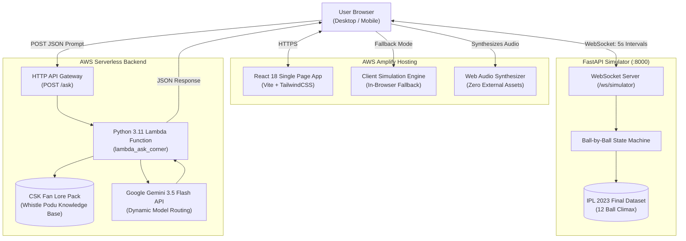

# DreamCompanion: Corner Edition

Real-time cricket companion prototype with split-screen match telemetry, dynamic win probability analytics, interactive delivery scrubbing, and AI fan commentary.

- **Live Web App**: [https://main.d2e975m5devjyo.amplifyapp.com](https://main.d2e975m5devjyo.amplifyapp.com)
- **Live AI Chat Endpoint**: `https://2w9xgvn0hi.execute-api.us-east-1.amazonaws.com/ask`
- **AWS Stack**: `DreamCompanionStack` (AWS Account `251523190812`, Region `us-east-1`)

---

## 1. System Architecture

The application uses a hybrid architecture designed for zero friction: it runs as a standalone cloud web application on AWS Amplify, connects to a serverless AWS Lambda backend for AI chat, and integrates with a FastAPI WebSocket server for high-frequency live match streaming.



---

## 2. Core Features

### Live Cricket Scoreboard & Match Telemetry
- Displays match scores, overs, required run rate (RRR), current run rate (CRR), and target equations (DLS adjusted).
- Individual batsman statistics (runs, balls, 4s, 6s, strike rate) with active striker markers.
- Bowler analysis figures (overs, maidens, runs conceded, wickets, economy).
- Ball capsule indicators color-coded by match event (`6` amber, `4` emerald, `W` rose, `•` dark slate).

### Win Probability Forecaster & Delta Meter
- Visual split-bar tracking real-time win probability between Chennai Super Kings and Gujarat Titans.
- Per-delivery Win Delta indicator measuring momentum swings (e.g. `▲ +49% CSK Shift` after Jadeja's six, `▼ -28% CSK Shift` on Dhoni's dismissal).

### Delivery Scrubber ("Momentum Time Machine")
- Click any historical ball capsule in the recent deliveries bar to inspect the match situation at that specific point in time.
- Historical scores, batting strike rates, bowling figures, and commentary update instantly.
- A single-click `Return to Live ➔` button restores the real-time simulation head.

### Match Momentum & Fan Tension Curve (SVG ECG)
- Dynamic visual waveform graphing fan tension index ($0-100\%$) across every delivery.
- Uses native SVG polylines and linear gradients with zero external charting dependencies.
- Tension thresholds: Steady State ($<60\%$), Building Momentum ($60-74\%$), High Tension ($75-89\%$), and Climax / Match Point ($\ge 90\%$).

### Web Audio Synthesizer
- Built on the native browser Web Audio API with zero external audio files.
- Synthesizes realistic stadium acoustics:
  - Willow bat crack on 4s and 6s with rising crowd resonance.
  - Low-frequency impact thud on wicket dismissals.
  - Fanfare chime chord for match victory.
- Politeness toggle (`Audio: ON / OFF`) in the controls toolbar.

### "Ask Corner" AI Companion (AWS Lambda + Gemini)
- Interactive conversational assistant powered by Google Gemini 3.5 Flash via AWS Lambda and HTTP API Gateway.
- Grounded with a hardcoded Chennai Super Kings Fan Lore Pack (Anbuden culture, Dhoni's tactical history, Jadeja's finishing record).
- Built-in offline fallback engine that generates tactical replies even when no external API key is configured.

### "What-If" Tactical Scenario Explorer
- Pre-configured clickable tactical scenarios that feed directly into the AI chat:
  - Mohit Sharma's length ball execution on 14.5.
  - The tactical outcome if Jadeja had taken a single on 14.5.
  - Dhoni's dugout instructions before the final two overs.
  - DLS calculation mechanics for the revised 171-run target.

### Dual-Engine Simulator
- **Cloud Mode**: Runs out of the box on AWS Amplify using an in-browser simulation loop. Visitors can test playback controls, speed toggles, and audio without running local servers.
- **WebSocket Streaming Mode**: Automatically connects to `ws://localhost:8000/ws/simulator` when the FastAPI backend is running locally.

---

## 3. Project Directory Structure

```text
DreamCompanion/
├── frontend/                     # React 18 + Vite + TailwindCSS
│   ├── src/
│   │   ├── components/
│   │   │   ├── Scoreboard.jsx         # Live scorecard with integrated delivery scrubber
│   │   │   ├── ShotVisualizer.jsx     # Broadcast ground radar, ball trajectory & wagon wheel
│   │   │   ├── KeyMomentsBar.jsx      # 30s Highlights Reel and one-click key moments jump
│   │   │   ├── WinProbabilityBar.jsx  # Live CSK vs GT win percentage & delta meter
│   │   │   ├── FanECG.jsx             # SVG fan tension and emotional curve
│   │   │   ├── AskCornerChat.jsx      # Messenger UI with suggestions and Gemini link
│   │   │   ├── WhatIfScenarios.jsx    # Clickable tactical scenario exploration cards
│   │   │   ├── MatchControls.jsx      # Play, pause, reset, step, speed, and audio toggles
│   │   │   ├── GuideBanner.jsx        # Evaluator guide and feature documentation
│   │   │   └── Header.jsx             # Top bar with connection status indicators
│   │   ├── services/
│   │   │   ├── websocket.js           # WebSocket client with reconnection backoff
│   │   │   └── api.js                 # HTTP client calling AWS API Gateway /ask
│   │   ├── constants/
│   │   │   └── fallbackData.js        # Full 12-delivery dataset for client fallback
│   │   ├── utils/
│   │   │   └── audioFx.js             # Web Audio API stadium sound synthesizer
│   │   ├── App.jsx                    # Root split-screen layout and state coordinator
│   │   ├── main.jsx                   # React DOM bootstrap
│   │   └── index.css                  # Tailwind styles and custom scrollbars
│   ├── package.json
│   ├── vite.config.js
│   ├── tailwind.config.js
│   └── amplify.yml                    # AWS Amplify build configuration
├── backend/                      # Python FastAPI Match Simulator
│   ├── app/
│   │   ├── main.py                    # FastAPI app, /ws/simulator endpoint, CORS, health probe
│   │   ├── simulator.py               # Match simulation state machine
│   │   ├── models.py                  # Pydantic v2 schemas (DeliveryUpdate, MatchInfo, etc.)
│   │   └── data/
│   │       └── match_data.json        # 2023 IPL Final ball-by-ball data and commentary
│   ├── tests/
│   │   ├── test_simulator.py          # State machine step, reset, and pause tests
│   │   └── test_api.py                # REST endpoints and health check tests
│   ├── Dockerfile                     # Container specification for AWS App Runner
│   ├── requirements.txt
│   └── .dockerignore
├── lambda_ask_corner/            # AWS Lambda Serverless AI Handler
│   ├── handler.py                     # Zero-dependency Lambda handler and Gemini router
│   ├── fan_lore.py                    # CSK Fan Lore Pack knowledge base
│   ├── ai_eval/                       # AI Prompt Evaluation Framework
│   │   ├── benchmark_suite.json       # 10 benchmark fan prompts & evaluation rules
│   │   └── evaluator.py               # Prompt scoring engine (persona, lore, latency)
│   ├── test_handler.py                # Lambda test suite (CORS, prompt formatting, errors)
│   ├── test_ai_eval.py                # Pytest suite for automated prompt testing
│   └── requirements.txt
├── infra/                        # AWS CDK v2 Infrastructure as Code (TypeScript)
│   ├── bin/
│   │   └── dream-companion.ts         # CDK App entrypoint
│   ├── lib/
│   │   └── dream-companion-stack.ts   # CDK Stack (Amplify, Lambda, API Gateway)
│   ├── package.json
│   ├── tsconfig.json
│   └── cdk.json
├── sam/                          # Alternative AWS SAM deployment template
│   └── template.yaml
├── scripts/
│   ├── run_local.sh                   # Launches FastAPI (:8000) and Vite (:3000) concurrently
│   ├── test_all.sh                    # Runs all unit tests, builds bundle, synthesizes CDK, runs AI eval
│   └── evaluate_ai_prompts.py         # AI Prompt evaluation runner (local / live API)
├── deploy.sh                     # Automated deployment script for AWS
├── AGENTS.md                     # Agent workspace configuration and operational guardrails
├── .env.example                  # Environment configuration template
└── README.md
```

---

## 4. Local Development

### Prerequisites
- Python 3.11+
- Node.js 18+ and npm
- AWS CLI configured (optional, only needed for cloud deployment)

### 1. Setup Virtual Environment & Dependencies

```bash
# Set up Python virtual environment
python3 -m venv .venv
source .venv/bin/activate
pip install -r backend/requirements.txt

# Install Frontend dependencies
cd frontend && npm install && cd ..

# Install CDK dependencies
cd infra && npm install && cd ..
```

### 2. Configure Environment (`.env`)

Copy the example configuration:
```bash
cp .env.example .env
```

To enable live Google Gemini AI responses, add your API key to `.env`:
```env
GEMINI_API_KEY=AIzaSy...
```
*(Get a free key at [Google AI Studio](https://aistudio.google.com/app/apikey). No credit card required.)*

If left empty, the application automatically uses the built-in offline CSK Fan Lore Engine.

### 3. Start Local Development Servers

Run both the FastAPI backend (`:8000`) and the React frontend (`:3000`) in one command:
```bash
./scripts/run_local.sh
```

- **Frontend Application**: `http://localhost:3000`
- **FastAPI Simulator**: `http://localhost:8000`
- **WebSocket Stream**: `ws://localhost:8000/ws/simulator`
- **FastAPI Documentation**: `http://localhost:8000/docs`

---

## 5. Verification & Testing

Run the full end-to-end verification pipeline with a single command:

```bash
./scripts/test_all.sh
```

This script executes six sequential verification gates:
1. **Backend Simulator Unit Tests** (18 tests via `pytest`): validates state transitions, ball increments, pause/resume behavior, and REST endpoints.
2. **Lambda Ask Corner Unit Tests** (8 tests via `pytest`): validates CORS handling, prompt formatting, Gemini routing, and error status codes.
3. **Frontend Integrity & Unit Tests**: validates 12 climax deliveries, audio synthesizer, and API endpoints.
4. **Frontend Production Build**: builds the bundle via Vite (`frontend/dist`) to verify zero TypeScript/JSX errors.
5. **AWS CDK Synthesis**: validates CloudFormation template generation via `cdk synth`.
6. **AI Prompt Quality & Factuality Evaluation**: runs the automated evaluation pipeline across 10 benchmark scenarios to verify persona alignment, tactical cricket grounding, conciseness, latency, and absence of robotic clichés.

### AI Prompt Response Quality Pipeline

The AI evaluation pipeline (`scripts/evaluate_ai_prompts.py`) ensures that "Ask Corner" AI responses meet strict production standards:

- **Persona Alignment (25%)**: Verifies Chennai Super Kings authentic voice, tone, and cultural vocabulary (Anbuden, Whistle Podu, Thala, Yellow army).
- **Factual Grounding (35%)**: Tests tactical match accuracy (e.g. 171 DLS target, Mohit's blockhole execution, Rayudu's 19 off 8, Jadeja's 10 off 2).
- **Conciseness (20%)**: Enforces strict word limits (15–120 words) suitable for live match glanceability.
- **Anti-Slop Guard (20%)**: Rejects robotic boilerplate phrases (e.g. *"As an AI language model"*, *"It is important to remember"*).
- **Latency Threshold**: Demands response times $< 6.0$s (averaging ~0.5s with failover guardrails).

Run the AI evaluation locally:
```bash
# Run local evaluation (Lambda handler + CSK Fan Lore fallback)
PYTHONPATH=lambda_ask_corner .venv/bin/python scripts/evaluate_ai_prompts.py

# Run AI evaluation via pytest
PYTHONPATH=lambda_ask_corner .venv/bin/pytest lambda_ask_corner/test_ai_eval.py -v

# Run evaluation against live AWS API Gateway endpoint
PYTHONPATH=lambda_ask_corner .venv/bin/python scripts/evaluate_ai_prompts.py --live
```

Individual component tests:
```bash
# Run backend tests only
PYTHONPATH=backend .venv/bin/pytest backend/tests/ -v

# Run Lambda unit tests only
PYTHONPATH=lambda_ask_corner .venv/bin/pytest lambda_ask_corner/test_handler.py -v

# Run frontend build only
cd frontend && npm run build && cd ..

# Run CDK synthesis only
cd infra && npx cdk synth && cd ..
```

---

## 6. API Reference

### WebSocket Protocol: `/ws/simulator`

#### Client Messages (Commands)
```json
{ "action": "start" }              // Start / resume playback
{ "action": "pause" }              // Pause playback
{ "action": "step" }               // Advance by exactly 1 delivery
{ "action": "reset" }              // Reset simulator back to ball 0
{ "action": "set_interval", "interval": 2.5 } // Set update frequency in seconds
```

#### Server Messages (Telemetry Updates)
- `init`: Broadcast when a client connects, sending current match info and state.
- `ball_update`: Broadcast on every ball transition.
  ```json
  {
    "type": "ball_update",
    "data": {
      "ball_index": 11,
      "over_display": "14.5",
      "runs_scored": 6,
      "is_wicket": false,
      "score_after": "167/5",
      "target": 171,
      "runs_needed": 4,
      "balls_remaining": 1,
      "crr": 11.23,
      "rrr": 24.00,
      "emotional_index": 94,
      "fan_bpm": 156,
      "win_prob_csk": 54,
      "win_prob_gt": 46,
      "win_prob_delta": 49,
      "is_milestone": true,
      "milestone_type": "SIX",
      "ai_commentary": "UNBELIEVABLE! Ravindra Jadeja stands tall and drills Mohit straight back over his head for SIX! 4 runs needed off 1 ball!",
      "batsmen": [
        { "name": "Ravindra Jadeja", "runs": 6, "balls": 5, "fours": 0, "sixes": 1, "on_strike": true },
        { "name": "Shivam Dube", "runs": 32, "balls": 21, "fours": 0, "sixes": 2, "on_strike": false }
      ],
      "bowler_stats": { "name": "Mohit Sharma", "overs": "2.5", "maidens": 0, "runs": 32, "wickets": 3 }
    }
  }
  ```
- `match_completed`: Broadcast when the 12th ball finishes or the target is reached.

### HTTP REST: `POST /ask`

Exposed via AWS API Gateway and routed to AWS Lambda:

#### Request
```bash
curl -X POST https://2w9xgvn0hi.execute-api.us-east-1.amazonaws.com/ask \
  -H "Content-Type: application/json" \
  -d '{
    "question": "Can Jadeja finish this with 10 needed off 2 balls?",
    "match_context": "Over 14.4, Score: 161/5, 10 runs needed in 2 balls. Striker: Ravindra Jadeja."
  }'
```

#### Response
```json
{
  "success": true,
  "response": "Whistle Podu! Never write off Sir Ravindra Jadeja in a chase. Mohit has nailed yorkers all over, but Jadeja has the reach to sit deep in the crease. If he gets under one, the championship is ours!",
  "provider": "gemini (gemini-3.5-flash)",
  "persona": "CSK Corner Companion"
}
```

---

## 7. Cloud Deployment (AWS CDK)

The infrastructure is provisioned through AWS CDK v2 (`infra/lib/dream-companion-stack.ts`):

1. **AWS Amplify**: Hosts the React 18 production bundle with automated route rewrites for single-page applications.
2. **AWS Lambda**: Executes `lambda_ask_corner/handler.py` on the Python 3.11 runtime (zero external package dependencies).
3. **AWS API Gateway**: HTTP API Gateway with CORS enabled for cross-origin frontend queries.

### Deploying to Your AWS Account

Ensure your AWS CLI credentials are active:
```bash
aws sts get-caller-identity
```

Deploy the stack:
```bash
./deploy.sh
```

To update the frontend bundle on AWS Amplify directly from your machine:
```bash
# Build production bundle
cd frontend && npm run build && cd ..

# Package and deploy via AWS CLI
cd frontend/dist && zip -r ../../frontend.zip . && cd ../..
DEPLOYMENT=$(aws amplify create-deployment --app-id d2e975m5devjyo --branch-name main --region us-east-1)
UPLOAD_URL=$(echo $DEPLOYMENT | jq -r '.zipUploadUrl')
JOB_ID=$(echo $DEPLOYMENT | jq -r '.jobId')

curl -H "Content-Type: application/zip" --upload-file frontend.zip "$UPLOAD_URL"
aws amplify start-deployment --app-id d2e975m5devjyo --branch-name main --job-id $JOB_ID --region us-east-1
rm -f frontend.zip
```

---

## 8. License & Fair Use

Built as a sports technology engineering prototype based on historical match events from the 2023 Indian Premier League Final (Chennai Super Kings vs Gujarat Titans). All team names, logos, and trademarks belong to their respective owners.
